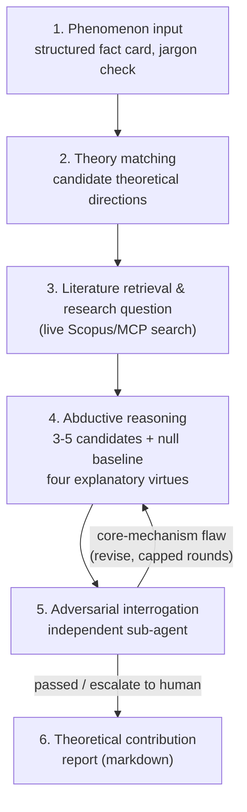

# ATBA — Abductive Theory-Building Agent


**A research prototype and proof-of-concept artifact.** ATBA makes the abductive-reasoning step of
qualitative theory-building — phenomenon → gap versus theoretical expectation → candidate construct —
explicit, structured, and auditable, rather than trying to automate a full paper. It is prepared as the
research artifact accompanying a Stage 1 submission to *Organization Science*'s "Call for Science"
AI-enabled special issue (category: AI-enabled qualitative research and theory-building).

This repository contains only the runnable system (backend + frontend). The proposal text and technical
appendix that motivate the design are submitted separately and are not included here.

**Want to see it work before installing anything?** Download [`demo.html`](demo.html) and open it in a
browser — it's the real frontend, statically rendering one genuine end-to-end run (live DeepSeek calls,
live Scopus retrieval) of all six steps, no backend or API keys required. See [`DEMO.md`](DEMO.md) for
what case it shows and how to regenerate it with your own.

## Key features

- **Auditable by construction, not by add-on logging.** Every step's full transcript — thinking, tool
  calls, structured output — is persisted and replayable in the order it actually happened; the frontend
  renders it as-is rather than a post-hoc summary (see [`frontend/README.md`](frontend/README.md)).
- **Anti-strawman retrieval.** Step 3's research question must be grounded in literature the agent
  actually retrieved in that same run (live Scopus search over the UT Dallas 24 journal list, MCP-based),
  never in the model's unaided "common sense" — see [`atba/mcp_server.py`](atba/mcp_server.py) and
  [`atba/retrieval.py`](atba/retrieval.py).
- **A null baseline, not just novel candidates.** Step 4 always includes one mandatory "do nothing to the
  anchor theory" candidate alongside the 3–5 generated ones, so every comparison has to beat a real
  zero-hypothesis, not just look plausible on its own.
- **Independent adversarial interrogation.** Step 5 is a separate sub-agent that only sees a candidate
  theory's object-level content — never step 4's own reasoning for why it picked that candidate — and can
  send it back for revision on a core-mechanism flaw (capped rounds, then escalates to a human).
- **Bilingual end to end.** Every prompt, and the frontend UI, ships in both English and Chinese
  (`lang="en"`/`"zh"`); output field names stay fixed English keys regardless of language.
- **Three LLM providers.** Runs against Anthropic, DeepSeek, or OpenAI without code changes
  (`--provider` / `ATBA_LLM_PROVIDER`) — see [`atba/README.md`](atba/README.md#provider--model-selection).

## How it works

ATBA implements a six-step pipeline. Every step is one auditable LLM agent run — the sequencing between
steps is explicit Python code, never something an agent decides on its own. Steps 4 and 5 are additionally
wrapped in a loop (revise-and-reinterrogate on a core-mechanism flaw), but the loop controller itself is
plain Python, not an agent.


The same structure, as a renderable flowchart with the exact conditional edges:



1. **Phenomenon input** — turns a free-text description into a theory-jargon-free, structured fact card;
   the agent judges for itself whether it has enough information, and identifies any prior causal
   expectations the user already brought to the phenomenon.
2. **Theory matching** — matches the phenomenon against a handful of plausible theoretical directions,
   without yet judging any gap.
3. **Literature retrieval & research question** — the validity-critical step: the agent independently
   calls a live literature-search tool (via MCP, over the Scopus API restricted to the UT Dallas 24
   journal list, with abstract lookup falling back to Semantic Scholar/OpenAlex) and produces a research
   question grounded in what it actually finds, never in the model's unaided background knowledge. Two
   lenses are applied — gap-spotting and problematization (Alvesson & Sandberg, 2011) — preferring
   problematization unless it fails a self-check for being obvious or absurd (Davis, 1971).
4. **Abductive reasoning & theory construction** — generates 3–5 mutually exclusive candidate theories,
   including a mandatory "null" candidate (the anchor theory unmodified) to check whether the new
   candidates actually improve on doing nothing, and scores them on four explanatory virtues
   (consilience, coherence, parsimony, precision).
5. **Adversarial interrogation** — an *independent* sub-agent, deliberately given only the candidate
   theory's object-level content (never step 4's own reasoning about why it chose that candidate),
   probes falsifiability, boundary conditions, and whether the construct is just an existing one wearing
   a new label. A core-mechanism flaw sends the candidate back to step 4 for revision (capped at a fixed
   number of rounds before escalating to human review).
6. **Theoretical contribution report** — pure aggregation and writing, no new reasoning: assembles a
   journal-style theory section (condensed introduction, theory & hypotheses with a Mermaid
   relationship diagram, theoretical contribution, references), honestly folding in step 5's unresolved
   weaknesses into a boundaries-and-limitations subsection rather than hiding them.

See [`atba/README.md`](atba/README.md) for the full architecture write-up, current scope, and known gaps.

## Status

All six steps are implemented and have been run end-to-end against live LLM calls (Anthropic and
DeepSeek) and live literature retrieval. OpenAI support is wired in the same way but is newly added and
has not yet been exercised on a real end-to-end run. See
[`atba/README.md`](atba/README.md#尚未实现--已知缺口) for what is still open — most notably, the
step-5-triggers-a-core-flaw-revision path is implemented and exercised but has not yet been observed
firing on a real case, and a semantic (embedding-based) local retrieval layer is not yet built.

## Quick start

Backend:

```bash
pip install -r atba/requirements.txt
cp atba/.env.example atba/.env
```

Open `atba/.env` and fill in at least these before starting the server — everything else in the file has
a working default:

| Variable | Why you need it |
| --- | --- |
| `ANTHROPIC_API_KEY`, `DEEPSEEK_API_KEY`, **or** `OPENAI_API_KEY` | At least one, so steps 1–6 can call a model at all. Set `ATBA_LLM_PROVIDER=deepseek` (or `openai`) if you didn't fill in the Anthropic key (default provider is Anthropic). |
| `SCOPUS_API_KEY` | Required for step 3's real literature retrieval. Without it, step 3 fails honestly with `retrieval_unavailable` instead of silently making something up — see [`atba/README.md`](atba/README.md#installation-and-running) for where to apply for one and its known Search-API-only limitation. |
| `ATBA_AUTH_USERNAME` / `ATBA_AUTH_PASSWORD` | The login the frontend asks for. Fine to leave as the file's default (`atba`/`atba`) for local use, but change both before deploying anywhere another person could reach the URL. |

Then start the server:

```bash
uvicorn atba.api:app --reload --port 8000
```

Frontend (in a second terminal):

```bash
cd frontend
npm install
npm run dev
```

Open `http://localhost:5173` and sign in with the username/password from `atba/.env` above.

Full details — every other environment variable, a CLI entry point that skips the frontend entirely, the
retrieval-infrastructure setup, and the HTTP API reference — are in [`atba/README.md`](atba/README.md);
the frontend's routes and streaming behavior are in [`frontend/README.md`](frontend/README.md).

## Project structure

```
demo.html, DEMO.md    # static offline demo — see "Want to see it work" above

atba/
├── step1.py … step6.py     # one module per pipeline step
├── abductive_loop.py        # step 4⇄5 loop controller (plain Python, not an agent)
├── schemas.py                # pydantic models — also the API contract and exported JSON Schemas
├── schemas/*.schema.json     # exported JSON Schema per step
├── prompts.py, prompts/      # system prompts, one {step}.{zh,en}.md pair per step + reusable skills
├── mcp_server.py, retrieval.py  # Scopus/Semantic Scholar/OpenAlex retrieval, as MCP tools
├── api.py                    # FastAPI backend (REST + streaming endpoints)
├── auth.py                   # single-account token auth (see docstring for its narrow threat model)
├── citation_audit.py          # verifies cited DOIs actually exist (steps 3-5)
├── cli.py                     # command-line entry point, one step at a time
└── examples/run_rider_case.py # end-to-end worked example

frontend/
├── vite.demo.config.ts   # builds demo.html (VITE_DEMO_MODE=true, inlined into one file)
└── src/
    ├── pages/Step1RunPage.tsx … Step6RunPage.tsx  # one route per step
    ├── components/TranscriptView.tsx, ReportView.tsx, MermaidDiagram.tsx
    ├── demo-data/             # the real run bundled into demo.html (see DEMO.md)
    └── i18n/                  # English/Chinese UI copy
```

## License

[MIT](LICENSE).
